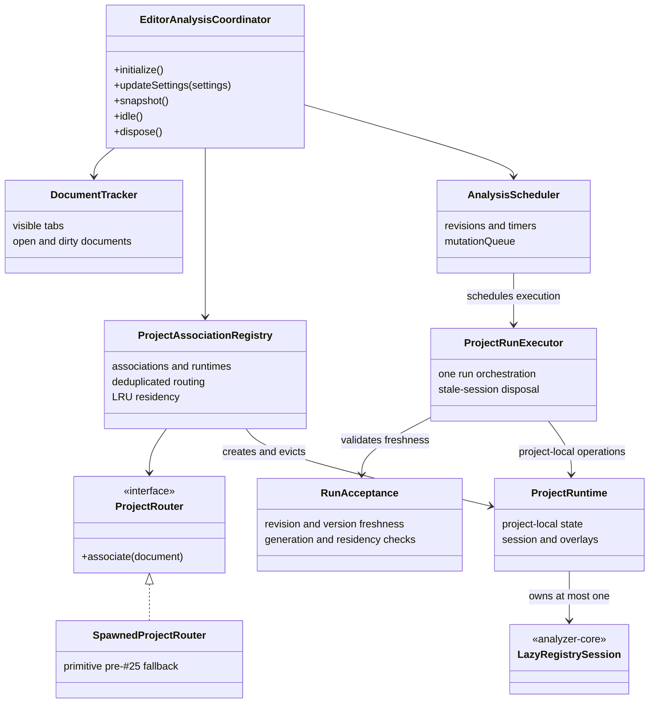

# TypeScript 7 Lit Analyzer VS Code extension

This package owns editor activation, document tracking, project routing, analysis scheduling, spawned registry-session residency, and VS Code integration. It consumes `analyzer-core` and does not implement component or template semantics. The repository-wide package boundaries and semantic design are described in [the architecture guide](../../docs/architecture.md).

The current implementation provides spawned host orchestration with real Extension Development Host coverage. Template analysis and language-feature providers remain follow-up work, and each TS7 program remains project-wide. Logical cancellation does not terminate native requests; native-preview pipe integration and runtime-complete packaging remain [#25](https://github.com/shining-mind/ts7-lit-analyzer/issues/25).

## Class structure

`EditorAnalysisCoordinator` is a mediator rather than an owner of every policy. Its collaborators keep document state, routing, scheduling, and per-project execution separate; analyzer semantics remain in `analyzer-core` and the engine.

## Configuration

The extension contributes these settings through `package.json`:

- `ts7LitAnalyzer.analysis.trigger`: `onType` (default) or `onSave`. Both modes analyze initially on open and reconcile save and close immediately. In `onSave`, unsaved changes update desired document state and mark the accepted view stale without mutating session overlays until save.
- `ts7LitAnalyzer.analysis.debounceMs`: 100 ms by default, and `ts7LitAnalyzer.analysis.maxWaitMs`: 500 ms by default. They apply to `onType`; maximum wait bounds scheduling postponement, not native execution or completion latency.
- `ts7LitAnalyzer.analysis.maxResidentProjects`: eight by default. The bound includes live and creating spawned sessions. A newly active project evicts an eligible older runtime instead of being denied analysis; reactivation reconstructs the complete current overlay set.
- `ts7LitAnalyzer.logging.level`: `normal` (default), `verbose`, or `debug`, written to the `TypeScript 7 Lit Analyzer` Output channel. Changes apply without restarting VS Code.

## Project routing

`SpawnedProjectRouter` is a **primitive pre-#25 fallback**, not TypeScript project-service routing. It selects the nearest containing `tsconfig.json` discovered once at router creation and uses a workspace-scoped inferred association when none contains the document. It does not honor custom config names or reproduce TypeScript's complete project-service algorithm for solution-style or multiply included files, and runtime tsconfig/reference-graph reloads remain unsupported. Connecting the native-preview transport, its default-project routing, and restart lifecycle remains #25. The `getDefaultProjectForFile` API evidence is preserved in `openspec/changes/add-analysis-host-policies/probes/project-association.mjs`, not in a production association session.

Native-preview uses open-file liveness rather than a numerical project LRU: [`cleanupConfiguredProjects`](https://github.com/microsoft/typescript-go/blob/main/internal/project/projectcollectionbuilder.go) retains default projects needed by open files, their references and ancestors, and explicitly opened API projects, while [`ProjectCollection`](https://github.com/microsoft/typescript-go/blob/main/internal/project/projectcollection.go) has no equivalent eight-project capacity. The extension's configurable bound applies only to its independent spawned registry sessions and must not be described as a native-preview limit. Deterministic residency races and real VS Code eviction and recovery are covered by `src/test/coordinator-races.test.ts` and `src/test/coordinator.test.ts`.

## Logging and diagnostics

Normal logging emits only important lifecycle events, warnings, and errors: it does not enable TS7 timing, module-resolution fallback counting, request timing snapshots, memory sampling, or instrumentation timers. Verbose adds correlated routing, scheduling, and lifecycle events, public timing, per-result module-resolution fallback counts, logical registry counts and overlay bytes, and explicitly scoped shared Extension Host heap/RSS. Debug adds version, generation, and staleness details and recent requests. Neither level logs source text, module specifiers used by the fallback, or ASTs, forces GC, nor guesses per-session native RSS.

Logical footprints and shared process memory are not exact per-registry allocations; the isolated probe's process-matching native RSS has separate limitations documented in [Performance measurements](../../docs/performance.md). Executable coverage lives in `src/test/logging.test.ts` and `packages/cem-analyzer-ts7/test/timing.test.ts`.
